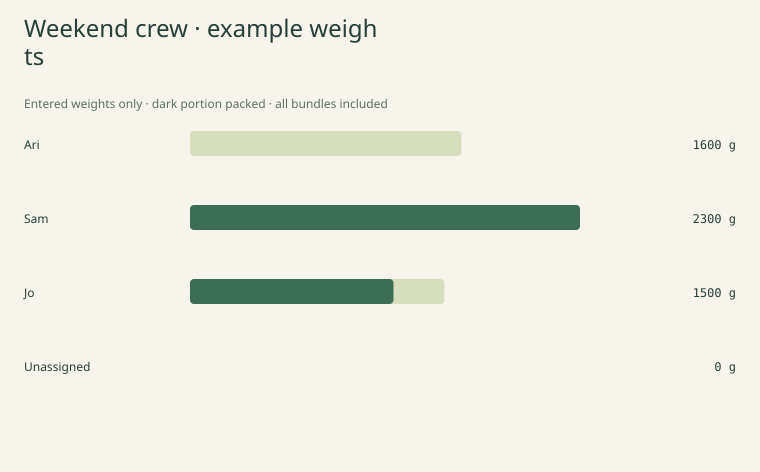

# Carrycrew

A browser-local packing desk for people travelling together. Put personal and shared gear in one plan, assign a carrier to each bundle, compare entered weights and mark whole bundles packed.



This is a real generated chart, **not an application screenshot**. Native browser visual checks and an editor screenshot have not been captured.

## Features

- One list for personal and shared items, with a named carrier or an explicit unassigned state.
- Exact weight arithmetic in integer milligrams; enter grams with up to three decimal places.
- Quantities, whole-bundle packed flags and per-person totals.
- A reviewable suggestion for unassigned **shared** bundles, preserving existing carriers.
- Search and filter without shrinking downloads or calculations.
- Undo/redo for applied gear, people, title, assignment and project-load changes.
- Resumable JSON, complete receipts, per-carrier HTML checklists and an SVG load chart.
- No account, upload endpoint, runtime dependencies, analytics or paid service.

## Run locally

Use Node.js 22 or 24 and npm.

```sh
npm ci --ignore-scripts --no-audit --no-fund
npm test
npm run build
npm run dev
```

Open `http://127.0.0.1:4196`. The preview binds to localhost and serves only allowlisted assets from `dist/`. Stop with Ctrl+C. The build uses Node built-ins; jsdom is a development-only test dependency.

## Use it

1. Set a title and add the people in your group.
2. Add bundles with a name, personal/shared kind, weight **per unit in grams**, quantity, carrier and packed flag.
3. Save the bundle. The full quantity stays with one carrier. To split a tent into parts, use separate rows for those parts.
4. Assign carriers manually or select **Suggest carriers**, inspect the complete draft and apply it.
5. Tick **All units packed** only when the entire bundle quantity is packed.
6. Save a JSON project before closing the tab. Export carrier checklists or a receipt to pass on.

Person names must be distinct ignoring case; Unicode normalization is not performed. Reassign a person's bundles before removing them. Removing a bundle is undoable.

Item-editor drafts must be saved or cleared before other board edits. Calculations, copy and downloads use applied data. Apply title changes with Set title and add a name with + Person before proceeding.

Loading a project or example replaces the plan and input drafts; the previous applied plan remains undoable. Invalid UTF-8, unsupported versions, invalid data, excessive file sizes and stale overlapping reads are rejected without replacing the current plan.

There is no autosave, cloud storage or live collaboration. One person maintains the file; exported copies do not synchronize.

## What the suggestion does

Existing assignments, including personal items, stay fixed. It considers only currently unassigned **shared** bundles, from heaviest total bundle mass to lightest. Each goes to the person with the lowest current assigned mass. Equal bundle weights follow list order; equal person totals follow person order.

The preview shows every proposed assignment and the before/after person totals. It does not change the plan until applied. Any intervening applied change invalidates it; unassigned personal gear always needs a manual carrier.

This is a simple greedy draft. It does not guarantee optimal balance, split quantities, move already-assigned items, evaluate gear ownership, consider bag capacity or determine a safe or suitable carrying load.

## Weights and packed state

For each row:

```text
bundle milligrams = per-unit milligrams × quantity
group total = assigned mass + unassigned mass
```

Input is grams from 0 to 50,000, with at most three decimal places. Values are parsed into exact integer milligrams; unsupported extra precision is rejected instead of rounded. Quantities are integers 1–99.

Every bundle is counted once. Personal/shared is a classification, not a multiplier. Packed flags do not change assigned or total mass. A packed bundle can still be unassigned; its mass remains visible in the unassigned total.

These are entered inventory weights. Nothing supplies product weights, recommends a packing list, validates trip readiness, or checks weather, airline allowances, personal suitability or equipment sufficiency. Weigh your own gear and make your own packing decisions. Demo names and weights are illustrative.

## Actual examples

Run `npm run example` to regenerate:

- [Initial editable project](examples/project.json)
- [Project after applying the example suggestion](examples/suggested-project.json)
- [Complete receipt](examples/receipt.json)
- [Load chart](examples/loads.svg)
- [Carrier checklists](examples/checklists.html)

The demo contains six bundles totalling **5,400 g**. Initially 1,400 g is unassigned. The suggestion keeps existing carriers and produces assigned loads of **1,600 / 2,300 / 1,500 g**.

## Files and exports

| File | Contents |
| --- | --- |
| Project JSON | `carrycrew-project-v1`: title, people, item identities, personal/shared kind, exact per-unit milligrams, quantities, carriers and packed flags |
| Receipt JSON | `carrycrew-receipt-v1`: complete item rows with derived mass/carrier names and exact group/person/packed/unassigned totals |
| Checklist HTML | Every person's bundles plus an unassigned section, quantities, per-unit/total grams and packed marks |
| Load chart SVG | Every person's assigned mass plus a separate unassigned row; dark portions show packed mass |

All exports cover the full applied plan regardless of filters. A receipt is not a resumable project. Projects do not store search state, unapplied inputs, undo history or suggestion previews. Unsupported fields and schema versions are rejected.

HTML and SVG text is escaped. No scripts, linked fonts or external images are included in exports. HTML has print styles, but physical printing and a particular application's layout behavior have not been verified. SVG labels wrap by code point; font metrics and complex grapheme layout are not controlled.

## Limits

| Boundary | Value |
| --- | --- |
| People | 1–8 |
| Item bundles | 0–100 |
| Quantity per bundle | 1–99 |
| Per-unit mass | 0–50,000 g, in 0.001 g increments |
| Trip title | 80 UTF-16 units |
| Person / item name | 32 / 80 UTF-16 units |
| Project text | 80,000 UTF-16 units |
| UTF-8 project file | 320,000 bytes |
| Applied undo snapshots | 25 |

Labels must be trimmed, nonempty, well-formed single-line Unicode without C0 controls, DEL or Unicode line separators. No unit conversion, product catalogue, CSV import, fractional quantities, split-bundle allocation, automatic sync or installed/offline cache is provided.

## Verification

`npm test` checks decimal parsing, independent mass partitions over 60 generated plans, deterministic previews, last-state validation, assignment preservation, person removal guards, maximum-size projects, complete escaped reports and file boundaries.

Real app handlers are tested in **simulated DOM**, including unapplied draft preservation, keyboard-focus restoration, packed-state preview invalidation, complete filtered exports, Blob contents/current URL attributes/revocation, undoable file recovery and overlapping file reads.

CI runs tests and build on Windows/Linux with Node 22/24. The Checks workflow also supports manual runs. These checks do not establish native browser rendering, responsive appearance, assistive-technology behavior, clipboard permissions, native download destinations or physical print results. A native editor screenshot remains pending.

## Deploy on Vercel

Import this GitHub repository on your existing account:

- Framework: **Other**
- Root directory: repository root
- Node.js: **24.x**
- Build command: `npm run build`
- Output directory: `dist`
- Install command: leave empty / override with no command

No environment variables, functions, databases, paid integrations or purchased domains are needed. `vercel.json` includes static build settings and security headers.

## Privacy and license

The plan remains in tab memory until you choose a copy/download operation. No browser storage, cookies, analytics, external fonts or application data requests are used. The host still serves static files and may retain ordinary request metadata. Closing the tab loses unsaved work.

MIT licensed; see [LICENSE](LICENSE).
